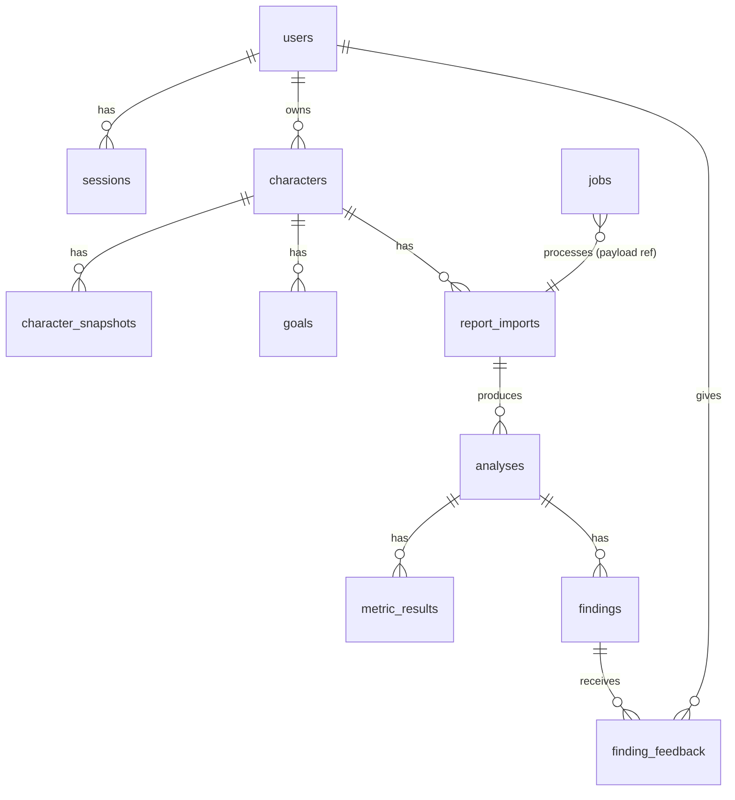

# Data Model

**Date:** 2026-11-02 · **Status:** Baseline v1 proposal. The first Alembic migration will implement this; any change goes through the DECISION_LOG.

## 1. Design rules
1. **Provenance on every row.** Each row is one of: `provider` (copied from Blizzard), `derived` (computed by Ascend), `user` (entered by the user) or `system`. Provider-originated rows record their source endpoint and `fetched_at`.
2. **Unknown is explicit.** Missing provider values are stored as `NULL`, with the reason in an `endpoint_status` / `data_coverage` JSON; never as `0` or `""`.
3. **No raw provider event data** in the database (D-006). Blizzard profile data is stored only in normalized, selected form, subject to the 30-day validity rule.
4. **Reference game data** (spells, cooldowns, dungeons, seasons, patch calendar, rule definitions) lives in **versioned files in the repository**, not in tables. The database stores version strings only. That avoids speculative tables and keeps rules reviewable in pull requests.
5. **Ownership:** every user-facing row is reachable from exactly one `users.id`. All of it is removed by `ON DELETE CASCADE` from `users`.
6. Timestamps are `timestamptz` (UTC). IDs are UUIDv7, generated in the app.

## 2. Entity mapping (directive §8.1)

| Concept | Where it lives | Provenance |
|---|---|---|
| Player | `users` | provider (Battle.net id) + system |
| Character | `characters` | provider |
| Character snapshot / equipment snapshot / talents (current) / M+ season bests | `character_snapshots.data` (JSON, validated schema `snapshot.v1`) | provider |
| Game version | `analyses.game_version` + `gamedata/patches.yaml` | derived + repo |
| Specialization | spec id in snapshot / analysis; names in `gamedata/` | provider / repo |
| Talent configuration *used in run* | `analyses.player_context.talents` | derived from log |
| Dungeon | `dungeon_id` columns + `gamedata/seasons/*.yaml` | provider id + repo |
| Dungeon run | `analyses` (one per imported key × rule set) | derived |
| Combat report | `report_imports` | provider reference |
| Encounter / pull | `analyses.pulls` (JSON: id, encounter_id, start_ms, end_ms, kill) | derived |
| Combat event | **not persisted** | – |
| Derived metric | `metric_results` | derived |
| Coaching rule | `ascend/analysis/rules/**` (code + YAML) | repo |
| Coaching finding | `findings` | derived |
| Supporting evidence | `findings.evidence` (JSON array, schema `evidence.v1`) | derived |
| Player goal | `goals` | user |
| Improvement history | query over `metric_results` × `analyses` (no table) | derived |
| Finding feedback | `finding_feedback` | user |

## 3. ERD


## 4. Schema (PostgreSQL 17)

```sql
CREATE TABLE users (
  id            uuid PRIMARY KEY,
  bnet_sub      text NOT NULL UNIQUE,          -- provider id (PII). Never logged raw.
  battletag     text NOT NULL,                 -- PII; display to owner only
  region        text NOT NULL CHECK (region IN ('us','eu','kr','tw')),
  created_at    timestamptz NOT NULL DEFAULT now(),
  last_login_at timestamptz NOT NULL DEFAULT now()
);

CREATE TABLE sessions (
  id           uuid PRIMARY KEY,
  user_id      uuid NOT NULL REFERENCES users(id) ON DELETE CASCADE,
  token_sha256 bytea NOT NULL UNIQUE,          -- raw token only in cookie
  created_at   timestamptz NOT NULL DEFAULT now(),
  last_seen_at timestamptz NOT NULL DEFAULT now(),
  expires_at   timestamptz NOT NULL
);
CREATE INDEX ON sessions (user_id);
CREATE INDEX ON sessions (expires_at);

CREATE TABLE characters (
  id                    uuid PRIMARY KEY,
  user_id               uuid NOT NULL REFERENCES users(id) ON DELETE CASCADE,
  region                text NOT NULL,
  bnet_character_id     bigint NOT NULL,       -- provider id; stable across rename (verify)
  realm_slug            text NOT NULL,
  name                  text NOT NULL,
  class_id              int  NOT NULL,
  last_status_check_at  timestamptz,           -- Blizzard 30-day rule
  status_valid          boolean,               -- NULL = never checked
  created_at            timestamptz NOT NULL DEFAULT now(),
  UNIQUE (user_id, region, bnet_character_id)
);
CREATE INDEX ON characters (last_status_check_at);   -- retention job scan

CREATE TABLE character_snapshots (
  id              uuid PRIMARY KEY,
  character_id    uuid NOT NULL REFERENCES characters(id) ON DELETE CASCADE,
  fetched_at      timestamptz NOT NULL,
  schema_version  text NOT NULL,               -- 'snapshot.v1'
  level           int,
  spec_id         int,
  hero_tree_id    int,
  equipped_ilvl   numeric(6,2),
  mythic_rating   numeric(8,2),                -- Blizzard value, never computed
  season_id       int,
  data            jsonb NOT NULL,              -- normalized selected fields (gear, enchant/gem flags, best runs)
  endpoint_status jsonb NOT NULL               -- {"equipment": 200, "mythic-keystone-profile": 404, ...}
);
CREATE INDEX ON character_snapshots (character_id, fetched_at DESC);

CREATE TABLE goals (
  id               uuid PRIMARY KEY,
  character_id     uuid NOT NULL REFERENCES characters(id) ON DELETE CASCADE,
  season_id        int  NOT NULL,
  kind             text NOT NULL CHECK (kind IN ('rating','key_level')),
  target_rating    numeric(8,2),
  target_key_level int,
  dungeon_id       int,                         -- NULL = any dungeon
  created_at       timestamptz NOT NULL DEFAULT now(),
  achieved_at      timestamptz,                 -- set only from Blizzard data
  archived_at      timestamptz,
  CHECK ((kind='rating' AND target_rating IS NOT NULL) OR (kind='key_level' AND target_key_level IS NOT NULL))
);
CREATE UNIQUE INDEX one_active_goal ON goals (character_id) WHERE archived_at IS NULL;

CREATE TABLE report_imports (
  id            uuid PRIMARY KEY,
  user_id       uuid NOT NULL REFERENCES users(id) ON DELETE CASCADE,
  character_id  uuid NOT NULL REFERENCES characters(id) ON DELETE CASCADE,
  provider      text NOT NULL DEFAULT 'wcl',
  report_code   text NOT NULL,                 -- sensitive if unlisted: owner-scoped
  fight_id      int,                           -- NULL until key selected
  visibility    text,                          -- provider value at import time
  status        text NOT NULL CHECK (status IN ('pending','fetching','analyzing','done','failed','rejected')),
  error_code    text,                          -- machine-readable reason (see ANALYSIS_ENGINE §8)
  requested_at  timestamptz NOT NULL DEFAULT now(),
  completed_at  timestamptz,
  UNIQUE (character_id, provider, report_code, fight_id)   -- idempotency
);
CREATE INDEX ON report_imports (user_id, requested_at DESC);

CREATE TABLE analyses (
  id                 uuid PRIMARY KEY,
  import_id          uuid NOT NULL REFERENCES report_imports(id) ON DELETE CASCADE,
  rule_set_version   text NOT NULL,
  engine_version     text NOT NULL,            -- git SHA / semver of analysis package
  game_version       text,                     -- NULL if undetermined
  game_version_uncertain boolean NOT NULL DEFAULT false,
  game_data_version  text NOT NULL,
  dungeon_id         int,
  keystone_level     int,
  timed              boolean,                  -- NULL if unknown
  duration_ms        bigint,
  run_started_at     timestamptz,
  player_context     jsonb NOT NULL,           -- spec, hero tree, talents (from log), deaths
  pulls              jsonb NOT NULL,           -- pull summaries only
  data_coverage      jsonb NOT NULL,           -- per dataType: requested/returned/pages/anomalies
  superseded_by      uuid REFERENCES analyses(id),
  created_at         timestamptz NOT NULL DEFAULT now(),
  UNIQUE (import_id, rule_set_version)
);

CREATE TABLE metric_results (
  id             uuid PRIMARY KEY,
  analysis_id    uuid NOT NULL REFERENCES analyses(id) ON DELETE CASCADE,
  metric_id      text NOT NULL,
  metric_version int  NOT NULL,
  scope          text NOT NULL,                -- 'run' | 'pull:<id>'
  status         text NOT NULL CHECK (status IN ('ok','invalid','not_applicable')),
  value          jsonb,                        -- NULL unless ok
  anomalies      jsonb NOT NULL DEFAULT '[]'
);
CREATE INDEX ON metric_results (analysis_id);
CREATE INDEX ON metric_results (metric_id, metric_version);

CREATE TABLE findings (
  id                  uuid PRIMARY KEY,
  analysis_id         uuid NOT NULL REFERENCES analyses(id) ON DELETE CASCADE,
  rule_id             text NOT NULL,
  rule_version        int  NOT NULL,
  kind                text NOT NULL CHECK (kind IN ('observation','suggestion','insufficient_evidence')),
  priority            int  NOT NULL,
  scope               text NOT NULL,
  statement           text NOT NULL,
  key_values          jsonb NOT NULL,
  confidence          text NOT NULL CHECK (confidence IN ('high','medium','low')),
  evidence            jsonb NOT NULL,          -- evidence.v1 array; must be non-empty for 'suggestion'
  limitations         jsonb NOT NULL DEFAULT '[]',
  recommended_action  text,
  validation_next_run text,
  CHECK (kind <> 'suggestion' OR (jsonb_array_length(evidence) > 0 AND recommended_action IS NOT NULL))
);
CREATE INDEX ON findings (analysis_id, priority);

CREATE TABLE finding_feedback (
  id          uuid PRIMARY KEY,
  finding_id  uuid NOT NULL REFERENCES findings(id) ON DELETE CASCADE,
  user_id     uuid NOT NULL REFERENCES users(id) ON DELETE CASCADE,
  verdict     text NOT NULL CHECK (verdict IN ('wrong','unclear','helpful')),
  comment     text CHECK (length(comment) <= 2000),
  created_at  timestamptz NOT NULL DEFAULT now(),
  UNIQUE (finding_id, user_id)
);

CREATE TABLE jobs (
  id          uuid PRIMARY KEY,
  kind        text NOT NULL,                   -- 'analyze_import' | 'refresh_character' | 'status_check'
  payload     jsonb NOT NULL,                  -- ids only, never tokens
  status      text NOT NULL CHECK (status IN ('queued','running','done','failed')),
  attempts    int  NOT NULL DEFAULT 0,
  run_after   timestamptz NOT NULL DEFAULT now(),
  locked_at   timestamptz,
  last_error  text,
  dedupe_key  text UNIQUE,                     -- e.g. 'analyze:<import_id>'
  created_at  timestamptz NOT NULL DEFAULT now()
);
CREATE INDEX ON jobs (status, run_after);
```

## 5. Sensitive records

| Table / column | Sensitivity | Note |
|---|---|---|
| `users.bnet_sub`, `users.battletag` | PII | Hash in logs |
| `sessions.token_sha256` | Credential derivative | Only the hash is stored |
| `report_imports.report_code` | Can grant access to unlisted reports | Never shown to another user |
| `analyses.player_context`, `findings` | Derived from possibly private reports | Owner-scoped. Storage permission pending WCL (W2) |
| `character_snapshots.data` | Blizzard data | 30-day validity rule |
| Provider tokens | **Not stored** in the MVP | – |

## 6. Retention implementation
- **Nightly `status_check` jobs:** characters with `last_status_check_at < now() − 25 days` are checked. A failing character is deleted; cascades remove its snapshots, goals, imports, analyses and findings, and the owner sees a notice on next login.
- **Analyses:** deleted after 180 days by default (pending W2).
- **Sessions:** expired rows are purged daily.
- **Account deletion:** `DELETE FROM users WHERE id = $1`, with cascades.

## 7. Example records (synthetic, for illustration only)
```json
{"finding": {"rule_id": "AR-01", "rule_version": 1, "kind": "suggestion", "confidence": "high",
  "statement": "On <boss> you used Deathmark 2 time(s); the fight allowed up to 3.",
  "key_values": {"uses": 2, "opportunities": 3, "alive_ratio": 0.98},
  "evidence": [{"type": "metric", "metric_id": "boss_cd_uses", "value": 2},
               {"type": "event_ref", "report_code": "<code>", "fight_id": 5, "pull_id": 14, "ts_ms": 1834000, "ability_id": "<deathmark id>"}],
  "limitations": ["Untargetable phases are not modeled."]}}
```
*This is synthetic: no real report or verified spell ID.*
