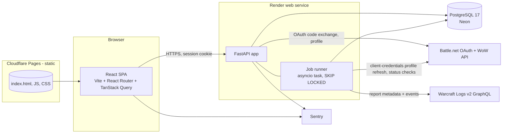

# System Architecture

**Date:** 2026-11-02 · **Status:** Baseline v1. Accepted for Stage 1; versions to be re-checked on the day of scaffolding.

## 1. Shape: a modular monolith
**One** Python backend (API plus an in-process job runner), **one** static React frontend, **one** PostgreSQL database. There are no microservices, message brokers, Redis or Kubernetes. The trigger for splitting out a separate worker process is defined in §9.



## 2. Technology selection (versions checked 2026-11-02 against PyPI/npm/nodejs.org; see `COST-10`)

| Layer | Choice | Version | Justification | Alternatives rejected |
|---|---|---|---|---|
| Language (BE) | Python | **3.14.x** (3.14.9, 2026-10-21) | Mature. 3.15 is too new for wheels | 3.15 |
| Web framework | FastAPI | 0.162.x (pin minor) | Typed models, OpenAPI generation for the frontend client, async HTTP | Django (heavier), Litestar (smaller ecosystem) |
| Models | Pydantic | 2.14.x | Contract validation for provider payloads | – |
| ORM / migrations | SQLAlchemy 2.1 + Alembic 1.20 | 2.1.6 / 1.20.1 | Versioned migrations, explicit SQL when needed | Raw SQL (more boilerplate), SQLModel (lags SQLAlchemy) |
| DB driver | psycopg 3 | 3.3.x | Native async, maintained | asyncpg (fine, but extra dialect) |
| HTTP client | httpx | 0.28.1 | Async, timeouts, transport mocking. **Note: no release since 2024-12; acceptable but watch** | aiohttp |
| ASGI server | uvicorn | 0.54.x | Standard | – |
| Tests (BE) | pytest 9.2, plus respx (HTTP mocks, version to verify) | – | – | – |
| Language (FE) | TypeScript | **7.0.x**, falling back to the latest 6.x if typescript-eslint or tooling incompatibilities appear in Stage 1 | Native compiler; check ecosystem compatibility first | – |
| UI | React | 19.3.x | Requirement | – |
| Build | Vite | 8.3.x | Fast, static output | – |
| Routing | React Router | 8.5.x, **SPA/data mode** | Static hosting, no server runtime | **Next.js 16** (see below) |
| Server state | TanStack Query | 5.105.x | Caching, retries, loading/error states | Redux |
| Tests (FE) | Vitest 5.0.x (5.1.0 released the same day as this review; let it settle), Testing Library, Playwright 1.64.x for E2E | – | – | Jest |
| Node runtime | Node 24 LTS or 26 LTS | 26.13.0 is the first 26.x LTS | Build only | – |
| Database | PostgreSQL **17** | Managed | PG 18 is supported by Neon but unconfirmed on Render/Supabase; 17 keeps hosts portable | – |
| Hosting FE | **Cloudflare Pages** (free) | – | Static. **No commercial-use ban, unlike Vercel Hobby** | Vercel Pro ($20/mo), justified only if SSR is ever needed |
| Hosting BE | **Render web service** (Starter, $7/mo) | – | Always-on (the free tier sleeps), simple deploys, pre-deploy migrations | Fly.io (no free tier, more ops), Railway (pricing unclear) |
| DB host | **Neon** (free, then Launch) | – | Scale-to-zero, no 30-day expiry (unlike Render's free Postgres), PITR on paid | Supabase (free tier pauses after 7 days) |
| Errors | Sentry Developer (free) | – | FE and BE | – |

**Why not Next.js?** The app is almost entirely authenticated, with no SEO-critical pages beyond a static landing page. Next.js would add a second server runtime (Node) alongside FastAPI, or push us onto Vercel, whose Hobby plan bans commercial use and Pro costs $20/mo. A static SPA plus FastAPI keeps one server runtime, one deploy target for logic, and free frontend hosting. **Revisit** if public, indexable pages (for example, shareable findings) become a requirement (DECISION_LOG D-004).

## 3. Backend module boundaries
```
backend/ascend/
  api/            FastAPI routers, request/response models, auth dependency (no business logic)
  auth/           Battle.net OAuth flow, sessions
  characters/     character service: import, refresh, status checks, snapshots
  goals/
  imports/        report import service: validation, idempotency, job enqueue
  analysis/       PURE: contracts, normalize, metrics, rules, priority, explain (no I/O)
  gamedata/       loader for versioned YAML/JSON reference data (spells, CDs, seasons, patches)
  providers/
    bnet/         adapter: token cache, rate limiter, typed responses, error mapping
    wcl/          adapter: GraphQL queries, pagination, points accounting, error mapping
    fixtures/     replay adapters for offline dev/tests (sanitized fixtures only)
  jobs/           runner, job handlers (analyze_import, refresh_character, status_check)
  db/             SQLAlchemy models, repositories (all queries user-scoped), Alembic
  observability/  logging config, redaction, Sentry init
```
- **Rules:** `analysis` imports nothing outside `analysis` and `gamedata`. Routers call services; services call repositories and providers. Enforced with import-linter in CI.
- Providers are behind `Protocol` interfaces (`CharacterSource`, `ReportSource`), so new providers or fixture replays slot in without touching services.

## 4. Authentication and authorization
```mermaid
sequenceDiagram
  participant U as Browser
  participant A as Ascend API
  participant B as Battle.net
  U->>A: GET /auth/login?region=eu
  A->>A: insert oauth_states row (hashed state, region, PKCE verifier if supported), set short-lived cookie
  A-->>U: 302 oauth.battle.net/authorize?client_id&redirect_uri&scope=openid wow.profile&state
  U->>B: login + consent (Blizzard UI; Ascend never sees password)
  B-->>U: 302 /auth/callback?code&state
  U->>A: GET /auth/callback
  A->>A: verify state == cookie-bound state (single use)
  A->>B: POST /token (code, client secret)
  B-->>A: access_token (~24h, no refresh token expected)
  A->>B: GET /oauth/userinfo ; GET /profile/user/wow
  A->>A: upsert user (sub, battletag), store character list in sessions.data (1 h), DISCARD token
  A-->>U: Set-Cookie: session (HttpOnly, Secure, SameSite=Lax); 302 /characters
```
- **Authorization:** a `current_user` dependency on every non-public route. Repositories require `user_id`. IDOR tests in CI.
- **Character list after login:** because the user token is discarded, re-listing characters requires signing in again ("Refresh character list" triggers the OAuth flow). That's acceptable; characters are added rarely.
- **Same-site requirement:** the frontend is at `app.<domain>` and the API at `api.<domain>`, on the same registrable domain, so SameSite=Lax cookies work. CORS allows only the app origin, with credentials.

## 5. Data ingestion flows
**Character refresh** (on selection; on visit when the snapshot is older than 24 h; manual, rate-limited to 1 per 5 min):
`refresh_character` job → bnet adapter (client token) → summary, equipment, specializations, keystone profile + current season → validate → normalize → insert snapshot (with `endpoint_status`) → update `characters`.

**Report import:**
```mermaid
sequenceDiagram
  participant U as Browser
  participant A as API
  participant J as Job runner
  participant W as WCL
  U->>A: POST /imports {url, character_id}
  A->>A: validate URL regex, ownership; upsert report_imports (idempotent)
  A->>A: enqueue analyze_import (dedupe_key)
  A-->>U: 202 {import_id, status}
  J->>W: report metadata (fights, dungeonPulls, actors, visibility, archiveStatus)
  J->>J: select key, match character, check spec/version -> reject early if unsupported
  J->>W: events per required dataType, sourceID=player, paginated (bounded pages)
  J->>J: analysis pipeline (pure) -> metrics, findings
  J->>A: persist analyses/metric_results/findings in one transaction; discard events
  U->>A: GET /imports/{id} (poll every 2s via TanStack Query)
  A-->>U: status / analysis_id
```
- **Bounds:** at most 200 pages per dataType, a 120 s total fetch timeout, and an in-memory event cap (e.g. 2M events). Exceeding any of them fails the job with the reason `too_large`.

## 6. API contract outline (v1, JSON, `/api/v1`)

| Method & path | Purpose | Notes |
|---|---|---|
| GET `/auth/login?region=` | Start OAuth | 302 |
| GET `/auth/callback` | Finish OAuth | 302 |
| POST `/auth/logout` | End session | 204 |
| GET `/me` | Current user (BattleTag, region) | 401 if anonymous |
| GET `/characters` | Characters stored for the user | |
| POST `/characters` `{region, bnet_character_id}` | Add a character from the cached session list | |
| GET `/characters/{id}` | Dashboard data (latest snapshot plus freshness) | |
| POST `/characters/{id}/refresh` | Queue a refresh | 429 if within cooldown |
| DELETE `/characters/{id}` | Delete character and dependent data | |
| GET/PUT `/characters/{id}/goal` | Read/set the active goal | |
| POST `/imports` `{character_id, url}` | Create or reuse an import | 202, idempotent |
| GET `/imports/{id}` | Status, `error_code`, key choices if several | |
| POST `/imports/{id}/select` `{fight_id}` | Choose the key | |
| GET `/analyses/{id}` | Run header, findings, insufficient-evidence list | |
| GET `/characters/{id}/plan` | Top ≤3 suggestions from the latest analysis | |
| GET `/characters/{id}/history` | Analyses plus per-rule trends, split by rule version | |
| POST `/findings/{id}/feedback` | Wrong / unclear / helpful | |
| DELETE `/me` | Delete account | |
| GET `/health` | Liveness, and DB check (`?deep=1`) | Public |

- **Errors:** `{"error": {"code": "report_private", "message": "...", "retryable": false}}`. Codes are listed in ANALYSIS_ENGINE §8.
- **Frontend client:** generated from FastAPI's OpenAPI schema (`openapi-typescript`; version to verify).

## 7. Frontend route structure

| Route | Screen |
|---|---|
| `/` | S1 Landing |
| `/signin`, `/auth/done` | S2 |
| `/characters` | S3 |
| `/c/:characterId` | S4 Dashboard |
| `/c/:characterId/review` | S5 Import |
| `/c/:characterId/analyses/:analysisId` | S6 Analysis |
| `/c/:characterId/plan` | S7 Plan |
| `/c/:characterId/history` | S8 History |
| `/settings` | S9 |
| `/privacy`, `/about` | Static pages |

## 8. Cross-cutting concerns

**Caching.**
- Blizzard: snapshots act as the cache (24 h TTL on visit) and the client token is cached in memory until it expires.
- Game data: in the repository, loaded at boot.
- WCL: **no response caching** beyond the job's in-memory lifetime (W2).
- API responses with user data: `Cache-Control: private, no-store`.
- Static assets: immutable hashed filenames.

**Rate limiting.**
- Blizzard: a token bucket of 50 rps and 30k/h (headroom under 100 rps / 36k/h).
- WCL: before each job, read `rateLimitData`. If the remaining points are below the job's estimated cost, set `run_after = now + pointsResetIn`.
- Per user: 20 imports/day and 1 refresh per 5 minutes.

**Retries.** Exponential backoff with full jitter: base 1 s, cap 30 s, at most 4 attempts, for 429/5xx/timeouts only. Never retry 4xx except 429. Jobs: at most 3 attempts, then `failed` with the error code.

**Idempotency.**
- Unique `(character_id, provider, report_code, fight_id)` on imports.
- `(import_id, rule_set_version)` on analyses.
- `dedupe_key` on jobs.
- The persist step runs in a single transaction.

**Logging and observability.**
- JSON logs with `request_id`, `job_id` and `user_hash`.
- A redaction filter for tokens, cookies, BattleTags and character names.
- Sentry with PII scrubbing on.
- Metrics, derived from logs initially: job duration, job failures by `error_code`, WCL points per job, Blizzard 429 count.
- Uptime check on `/health` with a free monitor.

**Errors.** Provider errors are mapped to domain error codes inside the adapters. The UI receives only the domain codes. Never surface provider error bodies.

## 9. Background jobs
- **In-process runner:** an asyncio task started at app lifespan. It polls `jobs` every 2 s using `SELECT … FOR UPDATE SKIP LOCKED` and runs at most 2 concurrent jobs.
- **Scheduled work** (`status_check` nightly, `session_purge` daily) uses self-rescheduling jobs, so no cron service is needed.
- **Split trigger:** move the runner to a separate Render background worker ($7/mo, same image, `python -m ascend.worker`) when p95 API latency degrades during imports, when more than one web instance is needed, or when queue wait p90 exceeds 60 s.

## 10. Testing strategy

| Level | Scope | Tooling |
|---|---|---|
| Unit (BE) | Metrics, rules, priority, normalizers, redaction | pytest. Golden fixture snapshots |
| Contract | Provider payloads parse with our Pydantic models; recorded sanitized fixtures; a scheduled weekly live-contract job (once credentials exist) that warns on drift | pytest + fixtures |
| Integration (BE) | API + DB (Postgres in CI service container); auth flow with a mocked provider; IDOR tests; deletion cascades | pytest, httpx ASGI client, respx |
| Unit (FE) | Components, finding-kind rendering rules | Vitest + Testing Library |
| E2E | Sign-in (mock OAuth in a test env), select character, import fixture report, view findings, delete account | Playwright against docker-compose with fixture adapters |
| Accessibility | Core screens | axe via Playwright |
| Performance | Dashboard render budget; analysis time on the largest fixture | Lighthouse CI; pytest timing |

**CI** (GitHub Actions): lint (ruff, eslint), type-check (mypy/pyright, tsc), tests, import-linter, secret scan, dependency audit. All must pass to merge.

## 11. Deployment
- `main` auto-deploys: Render (backend; pre-deploy `alembic upgrade head`) and Cloudflare Pages (frontend).
- **Migrations are backward-compatible** (expand, then contract) so a rollback of app code stays safe.
- Environments: `local`, `preview` (optional), `production`. Secrets live only in the provider dashboards. `.env.example` documents the names.
- Rollback: Render "rollback to previous deploy" and Pages "rollback". DB backups through Neon PITR (paid tier) or scheduled `pg_dump` to R2 on free tiers.

## 12. Local development
- `docker compose up db` (Postgres 17).
- `uv sync && uv run alembic upgrade head && uv run fastapi dev` (the uv version is to be verified at scaffold time).
- `pnpm i && pnpm dev`.
- `ASCEND_PROVIDER_MODE=fixtures` replays sanitized fixtures, so no credentials are needed for most work.
- `make check` runs every CI step locally.
